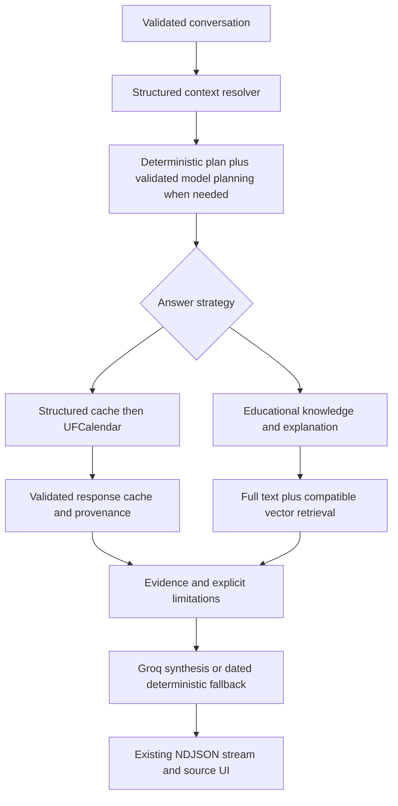

# Conversational chat architecture rebuild

Baseline verified 20 November 2026: production alias octagon-ai-indol.vercel.app resolves to deployment dpl_DrKYjH9BU9Lg8MMnJifR2XaBw92G, commit bfbf40b2326f1de32cfba9e42613599e468e6b3c, branch fix/stats-context-no-ufc-card. Local checkout was clean at 8a5e894. Dedicated branch refactor/conversational-chat-architecture starts at production; no UI redesign is planned.

## Audit and replacement

The existing understanding, Zod schemas, provider budget RPC, NDJSON transport, Admin sessions, source validation and additive migrations are reusable. Current defects: conceptual answers depend on database rows or one statistics canned response; common profiles/statistics bypass synthesis; three-sentence/450-token answer policy prevents useful explanations; chat does not pass query vectors to hybrid SQL; live responses are not cached by provider path; context retains entities inconsistently and loses comparison topics; all HTTP 429 responses block the account until next month, even minute rate limits.



Keep provider authentication, monthly quota reservations and abuse protection. Internal development budgets become configurable; no paid providers or production environment changes. Separate fetched_at from publisher timestamps. Cache failure must not discard validated evidence. Conceptual explanations may use stable domain knowledge; exact fighter facts and current claims require supplied evidence. Preserve historical snapshots with explicit dates and never infer retirement.

Verification will use synthetic provider fixtures, twenty acceptance queries and five contextual conversations, streaming tests, lint/typecheck/build, browser UI regression and limited live Preview checks. Operational execution and limitations are recorded below as work completes.

## Implementation and operations

The HTTP route validates conversation and streams NDJSON. `chat-orchestration` owns planning, context-aware evidence caching and diagnostics. `understanding` and `model-understanding` produce validated plans; the latter is only used for uncertain language. `fighter-resolution` resolves each comparison participant independently through UFCalendar when absent locally. `intelligent-retrieval` combines validated structured evidence with `knowledge-retrieval`. `provider-cache` validates reads and writes, deduplicates in-flight requests in a warm instance, retains observation dates, and persists path-specific responses across instances. `citation-guard` filters unsupported URLs, fictional citation markers and newly introduced numerical values before emitting each line. This consistency gate cannot prove the semantic correctness of prose or the association of a number with the right fighter.

UFCalendar search and profile contracts were checked against `docs/ufcalendar.openapi.json`; the implementation does not add another sports API. Search identities cache for seven days, profiles for one day, history/bout requests for seven days, event/rankings requests for fifteen minutes. Failed refreshes can use a validated snapshot less than thirty days old, retaining its fetched date. This is bounded stale-on-error, not an unbounded background refresh. In-flight deduplication is per warm process; simultaneous cold instances can still make duplicate requests. Durable quota RPCs remain account-wide. A minute rate limit gets a Retry-After cooldown, while monthly quota exhaustion remains blocked until reset. A single-account transient server failure gets one budgeted backoff retry. No external quota or credential requirement is bypassed.

The educational corpus contains five original source-backed documents covering fundamentals and techniques, statistics, judging, rankings terminology and weight classes. The rankings document distinguishes the historical media panel from UFC's announced June 2026 transition. The five documents were written and read back in Supabase. Seven compatible 384-dimensional document chunks are expected after indexing; the operational command reports the actual count. No complete roster import is claimed. Existing fighters plus validated on-demand discoveries are retained.

Commands (PowerShell; use npm.cmd/npx.cmd if execution policy blocks npm.ps1):

```powershell
npm.cmd run db:migrate
npm.cmd run knowledge:seed
npm.cmd run fighters:sync -- --resume
npm.cmd run fighters:sync -- "Georges St-Pierre"
$env:ENABLE_EMBEDDINGS='true'
$env:EMBEDDING_CACHE_DIR='.model-cache'
npm.cmd run ingest -- --kind=index --limit=20
npm.cmd run ingest -- --kind=index --reindex --resume --limit=20
npm.cmd run ingest -- --kind=fighter-history --fighter=khabib-nurmagomedov
npm.cmd run ingest -- --kind=fight-stats --fight=VERIFIED_NUMERIC_ID
npm.cmd run chat:operations
npm.cmd run benchmark:retrieval
npm.cmd run benchmark:chat -- http://localhost:3101
```

Migration `004_provenance_hybrid.sql` is additive and has NOT been applied: `SUPABASE_DB_HOST` and `SUPABASE_DB_PASSWORD` are not configured. The application remains compatible with the existing tables. New nullable provenance columns do not fabricate publisher timestamps; existing `updated_at` remains an ingestion observation. Provider-cache entries store fetched_at and a separate nullable publisher timestamp. Future importers should populate source_updated_at only when the provider explicitly supplies it.

Use the existing migration runner with those credentials supplied privately. Never paste database passwords into chat or commit them. Seed/index/profile scripts are idempotent; roster and index jobs have durable local cursors. Run jobs with `UFCALENDAR_MAX_REQUESTS_PER_RUN` and the existing monthly allowance. A refresh occurs on the next stale read; no recurring paid job was enabled.

Configuration: `CHAT_INTELLIGENCE_ENABLED`, `CHAT_LIVE_RETRIEVAL_ENABLED` and `CHAT_MODEL_UNDERSTANDING_ENABLED` now default true; explicit false remains a rollout/rollback control. `CHAT_PROVIDER_REQUEST_LIMIT` defaults six and is bounded at twelve per retrieval. `CHAT_RETRIEVAL_DAILY_LIMIT` defaults 1000 but never overrides the external monthly allowance. `AI_MAX_OUTPUT_TOKENS` defaults 1400. Explicit AI/client budgets override development/Preview defaults. Production defaults remain 100 AI attempts, 100000 conservatively reserved token units and 20 client requests/hour. Controlled local testing uses higher explicit limits without resetting counters. Embeddings are enabled with `ENABLE_EMBEDDINGS=true`; cold model loading has a three-second query wait budget before lexical fallback, and a warmed extractor is reused. All stored/query embeddings use Xenova/paraphrase-multilingual-MiniLM-L12-v2, normalized mean pooling, 384 dimensions and the same text truncation. Migration 004 excludes incompatible models from vector ranking. Never mix models without reindexing.

Database outages retain process-local abuse protection for educational fallbacks. Model and live-provider calls still fail closed if durable usage controls cannot reserve budget; this intentionally limits externally billed work during a control-plane outage. Source-backed educational answers remain available without network credentials. Optional OpenRouter fallback remains restricted to configured free models.

## Verification record

135 unit/integration/acceptance tests, TypeScript, ESLint and production build passed at the implementation checkpoint. All 18 Playwright cases passed using installed Chrome, covering desktop/mobile/narrow layouts, Admin sign-in, poster, original three-card stage, absence of the UFC logo card, typing and NDJSON rendering. No homepage, styling or Admin files were changed.

`conversational-retrieval-results.json` records eight passing database lexical/hybrid checks with actual query vectors. `conversational-live-results.json` preserves the first completed real-model sweep: 31/33 content gates passed. Two follow-ups failed HTTP validation because generated assistant messages exceeded the old 2500-character per-message bound. The revised boundary permits assistant messages up to 10000 characters while retaining the 2500-character user limit and 45000-character overall body bound; a regression test covers it. Targeted retest and Preview outcomes are appended after execution. A previously observed model-generated unsupported numerical benchmark motivated the new consistency gate; initial live outputs are retained as evidence, not silently relabelled as fully factual successes. The automated gates are not an independent factual accuracy certification.

## Release and rollback

Publish only the dedicated branch to Preview, test the actual deployed commit, and preserve production alias octagon-ai-indol.vercel.app at bfbf40b until release review. No production secrets, provider subscription or production alias were changed. Preview-only configuration is scoped to this refactor branch. For rollback of a future release, disable CHAT_INTELLIGENCE_ENABLED (and live/model flags for clarity) and redeploy the reviewed legacy commit. Do not delete database rows or reset quota counters. The additive migration does not need destructive reversal. Evidence cache version three avoids reuse of older strategy entries.

Final local correction: `conversational-live-retest.json` records three passing turns for the previously failing Khabib conversation, including record and submission-history follow-ups. A later output review also found body weight being described as a current competitive division; current-status inference now has an explicit streaming guard and regression coverage. The guard permits a status assertion only when the evidence supplies an explicit career-status field. Latest automated count is 136 passing tests. Production release readiness still requires semantic review of model prose; passing HTTP/content gates alone is insufficient.

Budget isolation correction: internal AI/client/retrieval counters now distinguish development and Preview from the legacy Production ledger. External UFCalendar reservations remain account-wide. Early live checks, before this correction, used the shared legacy AI counter; at the audit it held 136 reserved attempts and 1,298,456 conservative token units for 20 November UTC, above the existing Production caps. This can suppress legacy Production model generation until the UTC daily reset (21 November 00:00 UTC / 04:00 Asia/Yerevan). Deterministic legacy answers remain available. No counters were reset, no Production limits were increased, and later tests use isolated budgets. This operational impact must be considered before release. Latest automated checkpoint: 137 passing tests.

Event coverage correction: numbered UFC events are explicit plan entities, and contextual card/results questions retain the last event until a new fighter is explicitly named. Missing event identities resolve through the documented `/v1/search?q=` response, then a validated `/v1/events/{id}` detail call; no guessed slugs or unsupported q parameter on the event-list endpoint are used. Optional model plans can name an event subject for the same resolution path. Fighter profile parsing now preserves scope-specific career-stat rows instead of dropping them. Final local checkpoint: 139 passing tests, TypeScript, ESLint and production build. Eight lexical/hybrid database retrieval checks and eighteen browser cases passed. The corpus currently has five verified documents, seven compatible embedded chunks and the database contains 58 fighter identities/profiles; the latter includes existing data and on-demand discoveries, not a claimed full roster import.

Further semantic trace correction: the first submission-count retest used general-rule routing, so its numerical narrative was not sufficient evidence of correct retrieval. Method-of-victory queries now explicitly request fighter history, and a general summary computes observed wins by submission, KO/TKO and decision from validated history rows. Summaries state that supplied rows may be incomplete; no career completeness is inferred. This supersedes any factual-success interpretation of the older submission-count output. The acceptance regression asserts the history intent and correct fighter. Latest full suite: 140 passing tests. A final deployed submission-history smoke check is required below.

Real Preview cache-miss verification: before requesting Georges St-Pierre, a database read returned no Georges identity. The protected Preview returned a sourced profile through actual UFCalendar/Groq integrations, and a subsequent read verified fighter id 1341 was automatically written. A follow-up resolved his takedown-defense statistics. Live output exposed two citation formatting variants (mixed bracket syntax and a root URL with/without trailing slash); the stream filter now canonicalizes equivalent URLs and repairs those brackets while continuing to remove unsupported links. Latest full suite: 141 passing tests, TypeScript, ESLint and production build.

Metric-scope correction: one real answer confused a UFC win count with the sample behind a performance metric. `fighter-evidence.ts` now projects the requested metric and its explicit basis into generation evidence, excludes unrelated record counters, and preserves scope-specific panels separately when no aggregate panel exists. Current explicit topics take precedence over inherited topics. Prior assistant messages are explicitly treated as unverified. Evidence-cache version four prevents reuse of older broad payloads. A regression verifies that a 22-bout UFC-only sample is carried with takedown defense while unrelated records and SLpM are excluded. Latest full suite: 142 passing tests. Local Admin credentials are absent, so live privileged Admin login was not executed; session security unit tests and sign-in-page browser regression passed, and Admin source/UI files remain unchanged.
