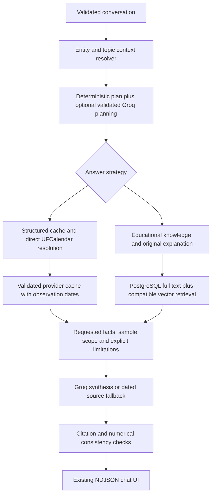

# OCTAGON conversational chat rebuild

Prepared 20 November 2026. Branch: `refactor/conversational-chat-architecture`.

## Baseline and preservation

Production was verified through Vercel deployment metadata at `bfbf40b2326f1de32cfba9e42613599e468e6b3c` on `fix/stats-context-no-ufc-card`, deployment `dpl_DrKYjH9BU9Lg8MMnJifR2XaBw92G`. The original checkout was clean at `8a5e894` on `feat/home-chat-polish`. The refactor branch starts from verified Production, rather than main or the stale local checkout. Main was not modified. No homepage, CSS, component or Admin source files were changed. The poster, three original cards, Russo One typography, dark/red presentation, browser history, typing indicator and NDJSON transport are preserved; the floating UFC logo card remains removed.

The pre-implementation audit and proposal were committed in this report's history. The existing code restricted the model to three short sentences, bypassed synthesis for common profiles/statistics, treated most empty retrievals as refusals, did not pass query embeddings to chat knowledge search, lost some comparison/topic context, and treated every provider 429 as monthly exhaustion. Assistant history was also bounded to the same 2500 characters as user inputs, causing follow-ups to fail after longer generated answers.

## Architecture



| Responsibility | Implementation |
| --- | --- |
| HTTP boundary and orchestration | `src/app/api/chat/route.ts`, `src/lib/chat-orchestration.ts`: input/origin/rate validation, planning, evidence acquisition, generation budgeting, cancellation and NDJSON frames. User messages remain limited to 2500 characters; assistant history permits 10000. The body remains bounded to 45000 characters and 16 messages. |
| Understanding and context | `understanding.ts`, `model-understanding.ts`, `chat-strategy.ts`: directory-driven normalization, aliases, bounded fuzzy matching, ambiguity, nearest subjects, explicit-topic precedence and inherited comparison metrics. Exact full identities outrank incidental shared-name tokens. Uncertain language can use a Zod-validated Groq plan. |
| Fighter and event resolution | `fighter-resolution.ts`, `event-resolution.ts`: no pre-import requirement. Each missing comparison participant can be searched separately. Profile requests can retrieve documented source-graded career credentials; confirmed and reported claims retain their distinction. Named events use documented global search followed by verified event detail, rather than guessed slugs or unsupported event-list parameters. Numbered event follow-ups retain event context until an explicit new subject. |
| Evidence projection | `fighter-evidence.ts`: requested metrics retain their source sample/basis and omit unrelated record counters. Scope-specific career rows are preserved when an aggregate panel is unavailable. `history-summary.ts` computes observed victory-method counts from validated history, explicitly without claiming complete career coverage. |
| Structured provider | `ufcalendar.ts`, `live-retrieval.ts`: existing server-side authentication, Zod responses, bounded timeouts, one budgeted transient server-error retry, rate-limit cooldowns, monthly quota blocking and safe failures. Request-time lookups retain the configured primary account; no cross-account quota rotation or additional sports provider was added. |
| Caching | `provider-cache.ts`, `cache.ts`: validated path-level memory/database read-through cache, warm-instance in-flight deduplication, retained fetched dates, best-effort persistence and bounded dated fallback on refresh failure. Evidence-cache version four separates revised projected evidence from older entries. |
| Knowledge and hybrid retrieval | `knowledge.ts`, `knowledge-retrieval.ts`, `embeddings.ts`, migrations 003/004: original educational summaries, PostgreSQL full text and optional normalized mean-pooled 384-dimensional embeddings. Indexing and queries share the same model and preprocessing. A cold query waits at most three seconds for embeddings before lexical fallback; the extractor is reused when warm. |
| Generation and validation | `ai.ts`, `citation-guard.ts`: natural explanations, source-only exact claims, schema-independent educational explanations, scoped comparisons and moderate detail. Streaming checks normalize supplied URLs, remove invented reference markers/URLs, withhold newly introduced numerical figures and reject unsupported active/retired status assertions. These are consistency checks, not a proof of semantic correctness. |
| Operations | Seed/sync/index scripts, operations counters, retrieval benchmark and opt-in live acceptance harness under `scripts/`. Logs use request ID, stage, intent, entity IDs, recognized topic, source count, latency and fallback status; raw conversation text and credentials are excluded. |

Stable educational questions can receive useful explanations without structured rows or provider credentials. Fighter facts, exact numbers, results, current rankings, dates and status still require supplied evidence. Prior assistant prose is not treated as verified evidence. Dated announcements do not establish whether a later rollout is complete or ongoing.

## Provider contract, quotas and freshness

The integration was checked against `docs/ufcalendar.openapi.json`. Relevant existing endpoints remain fighter search/profile/history, individual fights/statistics, events/cards/results and rankings. Event identity resolution additionally uses the documented `/v1/search?q=` response. No invented provider endpoint or paid sports-data service was introduced.

Provider cache categories currently use seven days for fighter search and history/bout request paths, one day for profiles and fifteen minutes for event/rankings paths. A failed refresh can retain a validated snapshot less than thirty days old, preserving its fetched date. This implements bounded stale-on-error; it is not a background stale-while-revalidate scheduler or a live-round latency guarantee. Warm-process deduplication does not guarantee single-flight across simultaneous cold Vercel instances. Durable provider budgets remain shared across the account.

HTTP `rate_limited` receives a Retry-After cooldown; only `quota_exceeded` blocks the account until monthly reset. Retries are charged to the same account budget. Source timestamps are never fabricated from retrieval time. Provider-cache entries store `fetched_at` and a separate nullable publisher timestamp; embedded provider career-row timestamps are preserved when supplied. Legacy database `updated_at` represents an ingestion observation, not a publisher update.

Internal AI/client/retrieval budgets are now isolated between development, Preview and the legacy Production ledger. External UFCalendar allowance remains account-wide. No provider plan, billing tier, Production secret or Production alias was changed.

**Operational impact:** early live checks, before budget isolation was implemented, used the existing shared AI ledger. Its 20 November UTC counter reached 136 reserved attempts and 1,298,456 conservative token units, above Production's existing daily caps. This can suppress legacy Production model generation until **21 November 00:00 UTC / 04:00 Asia/Yerevan**. Deterministic legacy responses remain available. No counters were reset and no Production caps were increased. Subsequent Preview requests use separate counters; a later audit confirmed that the legacy counters stayed unchanged.

The last account audit recorded 54 UFCalendar monthly reservations against the configured local ceiling of 80. This is the internal reservation count, not an independently queried statement of the provider's remaining allowance.

## Database and ingestion

Five original source-backed educational documents were written and read back from Supabase: fundamentals/techniques, interpreting statistics, judging, rankings terminology and weight classes. The rankings summary separates the historical media panel from the dated 2026 transition announcement and does not claim a verified current rollout stage. The latest reindex produced eight compatible chunks. The roster contains 59 profiles, including existing rows and verified on-demand discoveries; a complete roster import is **not** claimed.

A real Preview test first confirmed that Georges St-Pierre was absent from the database. Chat resolved and answered through UFCalendar/Groq, after which a read verified automatically persisted fighter ID 1341. A follow-up resolved his takedown-defense statistic. Victory-method retrieval returned Khabib's 11 submission wins from the provider's supplied history summary, with coverage limited to those rows. Named-event retrieval resolved UFC 300 and its sourced card through global search plus event detail.

`004_provenance_hybrid.sql` is additive and has **not** been applied because `SUPABASE_DB_HOST` and `SUPABASE_DB_PASSWORD` are unavailable. It adds nullable provenance fields/indexes and excludes incompatible embedding models from vector ranking. Existing migration 003 already performs the tested lexical/vector search, and the stored corpus uses the compatible model. The application remains compatible with the existing schema. Supply migration credentials privately through the environment and use the existing runner; do not reset tables or counters.

```powershell
npm.cmd run db:migrate
npm.cmd run knowledge:seed
npm.cmd run fighters:sync -- --resume
npm.cmd run fighters:sync -- "Georges St-Pierre"
$env:ENABLE_EMBEDDINGS='true'
$env:EMBEDDING_CACHE_DIR='.model-cache'
npm.cmd run ingest -- --kind=index --limit=20
npm.cmd run ingest -- --kind=index --reindex --resume --limit=20
npm.cmd run ingest -- --kind=fighter-history --fighter=khabib-nurmagomedov
npm.cmd run ingest -- --kind=fight-stats --fight=VERIFIED_NUMERIC_ID
npm.cmd run chat:operations
npm.cmd run benchmark:retrieval
npm.cmd run benchmark:chat -- http://localhost:3100
```

Use `--dry-run` for a no-provider-call sync preview. Roster/detail and reindex operations retain local cursors, and roster/detail upserts are retry-safe. Document indexing is not transactional; an interrupted chunk rebuild can require repair, so verify chunk coverage after failed jobs. A selected-profile run accepts one quoted search; omitting it uses the provider's actual resumable roster. Provider execution limits and monthly reservations apply to ingestion. Refresh occurs on stale reads or an explicit sync; no recurring paid job was enabled. Use npm.cmd/npx.cmd when PowerShell policy blocks npm.ps1.

## Configuration

See `.env.example`. Intelligence, live retrieval and optional model understanding default on; explicit false retains rollout controls. `CHAT_PROVIDER_REQUEST_LIMIT` defaults six and is bounded at twelve. `CHAT_RETRIEVAL_DAILY_LIMIT` defaults 1000 and cannot override external allowance. `AI_MAX_OUTPUT_TOKENS` defaults 1400. Explicit AI/client budget values override development/Preview defaults. Production defaults remain 100 reserved AI attempts, 100000 conservative token units and 20 client requests/hour.

Preview-only flag/allowance overrides were scoped to `refactor/conversational-chat-architecture`, including `ENABLE_EMBEDDINGS=true`. The model is `Xenova/paraphrase-multilingual-MiniLM-L12-v2`, 384 dimensions, normalized mean pooling and identical query/index text truncation. Never mix models without reindexing. Optional OpenRouter fallback remains restricted to configured free models. Durable model/provider budgets fail closed during a control-plane outage; process-local abuse protection still permits local educational fallbacks. No API key is exposed to the browser.

## Verification and limits

| Check | Observed result |
| --- | --- |
| Vitest unit/integration/acceptance | 143 passed on the final code checkpoint, including all twenty requested plan cases, five conversation patterns, empty-directory comparisons, event identity, metric projection, cache deduplication/cancellation and source validation. Synthetic fixtures consume no live quota. |
| TypeScript, ESLint, production build | Passed. |
| Playwright | All 18 cases passed with installed Chrome across desktop, mobile and narrow layouts. Poster, three original cards, removed logo card, Admin sign-in, typing and NDJSON rendering were covered. |
| Database hybrid benchmark | Eight passing lexical/hybrid checks with actual compatible query vectors; see `conversational-retrieval-results.json`. |
| Initial real-model sweep | Twenty questions plus five conversations (33 requests): 31 content gates passed; two failed the old assistant-history bound. Original outputs are preserved in `conversational-live-results.json`. |
| History-bound correction | All three turns of the previously failing conversation passed; see `conversational-live-retest.json`. These outputs predate later semantic corrections and are not relabelled as comprehensive factual passes. |
| Real Preview checks | Homepage, streamed educational explanation, cache-miss fighter lookup/persistence, contextual metric retrieval, sourced method-of-victory count and named-event/card retrieval were exercised. Final checkpoint details are in the Preview results artifact and release note below. |
| Secrets | Known-pattern scan passed; ignored `.env.local` was neither printed nor committed. |
| Admin privileged login | Not executed live because local operator credentials are unavailable. Session security unit tests and sign-in-page browser tests passed. |

Actual generated content was reviewed, not merely HTTP status. Live review found and corrected fictional reference syntax, unsupported numerical benchmarks, inferred competitive status, submission counts routed to rules, and confusion between record counts and metric samples. The historical rankings announcement also required an explicit distinction from unknown current implementation status. These observed failures and the targeted fixes are why older raw outputs remain as audit evidence rather than being presented as a 100% factual score.

The benchmark is a small engineering acceptance set, not an independent factual-accuracy certification. Numeric/source checks cannot prove every qualitative statement, association or explanation. Provider coverage, subscriptions and freshness still limit records, current status, news and historical completeness. No permitted news feed was added. Model output still warrants semantic review before a Production release. There is no latency SLA; first-look provider work and cold model loading can be slower than warm cached responses.

## Release and rollback

Production remains `https://octagon-ai-indol.vercel.app` at the verified baseline. The dedicated refactor is delivered through an immutable Preview deployment; exact tested commit/URL are recorded in the release note below. No failing local build was deployed. Temporary Vercel share access was used for protected HTTP testing without disabling deployment protection; share tokens and cookies are not stored in reports.

Before Production: review the Preview's generated content and coverage, apply migration 004 with authorized database credentials, and account for the legacy daily-quota impact described above. Do not silently promote the refactor. For rollback after a future reviewed release, set `CHAT_INTELLIGENCE_ENABLED=false` (also disabling live/model flags for clarity) and redeploy the reviewed legacy commit. Evidence-cache version four separates revised evidence entries. Do not delete data, reverse additive schema changes destructively, or reset quota counters.

## Final release handoff ? scope frozen

Application commit: `559c4575a4115587f96b833cb66c9c5edd5bc517`.

Verified READY Preview: https://octagon-b5a1p42ce-dansonofbass-projects.vercel.app

Deployment: `dpl_5M7rmpUqRMZkKRJKSwGSTg6rfUYf`. Only documentation/results were updated after this application commit. The final evidence is saved in `conversational-release-readiness.json`; no share token or cookie is included.

Exactly three final live requests were made after scope freeze. All returned HTTP 200, source frames and completed NDJSON streams: general MMA explanation, an enriched Georges St-Pierre profile, and a contextual takedown-defense follow-up. The follow-up retained the correct fighter and reported 85% across 22 UFC bouts. No HTTP 429 or error frame was observed. No full live benchmark was rerun.

The functional paths are verified; Production release is **held**. The general SLpM answer contained an incorrect phrase that fight time includes stoppage time. This is recorded as an unresolved content-quality issue, not counted as a fully factual acceptance pass. Profile references can also repeat. No further application features or architecture changes were made after the scope-freeze instruction.

The database ledger was read directly: 001_initial.sql, 002_history.sql and 003_search.sql are applied. **Only 004_provenance_hybrid.sql is pending.** Its additions are nullable fetched/source timestamp columns, identity/history indexes, and compatible-model filtering in hybrid search. Apply using `npm.cmd run db:migrate` once SUPABASE_DB_HOST and SUPABASE_DB_PASSWORD are supplied privately. No migration was attempted during final verification.

Remaining release holds/limitations: apply migration 004; correct/review the known answer wording; account for the legacy Production daily AI allowance until its stated reset; and perform privileged Admin login verification when operator credentials are available. Existing Production deployment remains at `bfbf40b2326f1de32cfba9e42613599e468e6b3c` (`dpl_DrKYjH9BU9Lg8MMnJifR2XaBw92G`). No Production deployment or promotion was performed.
